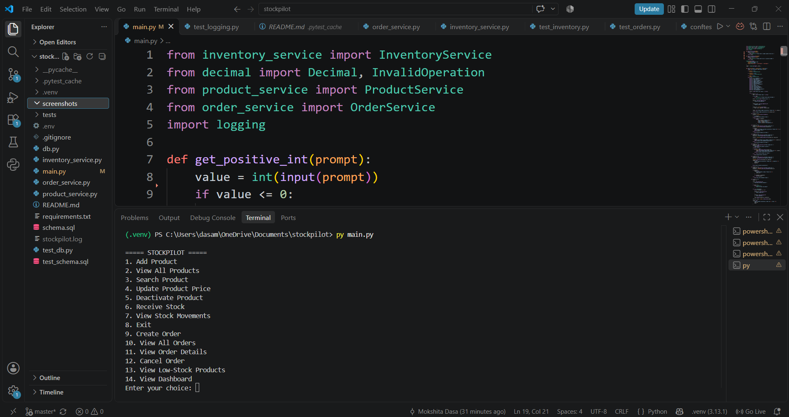

# StockPilot – Inventory & Order Management System

## Project Overview

StockPilot is a Python-based Inventory and Order Management System developed using Object-Oriented Programming (OOP) concepts and MySQL. It helps businesses manage products, monitor stock levels, process customer orders, and maintain inventory records.

The system provides a menu-driven interface with database integration, input validation, error handling, logging, and automated testing.
## Application Screenshot

## Features

- Add and view products.
- Search products by product ID.
- Update product prices.
- Deactivate products.
- Receive and manage stock.
- Track stock movements.
- Create customer orders.
- View order history and order details.
- Cancel orders and automatically restore stock.
- Generate low-stock alerts.
- Display an inventory dashboard.
- Validate user inputs.
- Maintain application logs.
- Perform automated testing using pytest.

## Technologies Used

- **Programming Language:** Python
- **Database:** MySQL
- **Database Connectivity:** MySQL Connector
- **Environment Management:** python-dotenv
- **Testing Framework:** pytest
- **Development Environment:** Visual Studio Code

## Database Structure

The project uses five relational database tables:

1. **suppliers** – Stores supplier information.
2. **products** – Stores product details, prices, and stock quantities.
3. **orders** – Stores customer order information.
4. **order_items** – Stores individual products included in each order.
5. **stock_movements** – Tracks stock received and stock deducted.

## Project Structure

stockpilot/
│
├── main.py
├── db.py
├── product_service.py
├── inventory_service.py
├── order_service.py
├── schema.sql
├── test_schema.sql
├── requirements.txt
├── .env
├── stockpilot.log
├── README.md
│
└── tests/
    ├── conftest.py
    ├── test_products.py
    ├── test_inventory.py
    ├── test_orders.py
    └── test_logging.py

## Installation and Setup

### 1. Clone the Repository

git clone <your-github-repository-url>
cd stockpilot

### 2. Create a Virtual Environment

python -m venv .venv

### 3. Activate the Virtual Environment

For Windows:

.venv\Scripts\activate

### 4. Install Dependencies

pip install -r requirements.txt

### 5. Configure Environment Variables

Create a `.env` file in the project root directory:

DB_HOST=localhost
DB_PORT=3306
DB_USER=root
DB_PASSWORD=your_mysql_password
DB_NAME=stockpilot_db

Replace the placeholder password with your local MySQL password. Do not upload your actual `.env` file to GitHub.

### 6. Create the Database

Open MySQL Workbench and execute the SQL commands in `schema.sql` to create the project database and tables.

### 7. Run the Application

python main.py

## Running Automated Tests

The project uses pytest for automated testing.

Run all tests:

python -m pytest -v

The tests use a separate test database to avoid modifying the main project database.

**Latest test result: 23 passed.**

## Logging

StockPilot uses Python's built-in logging module to record:

- Successful application operations.
- Invalid user inputs.
- Unexpected application errors.

Log information is stored in `stockpilot.log`.

## Key Concepts Demonstrated

- Object-Oriented Programming.
- CRUD operations.
- Relational database management.
- SQL transactions and rollback.
- Stock management and business logic.
- Input validation and exception handling.
- Application logging.
- Automated software testing.

## Future Enhancements

- User authentication and role-based access.
- Graphical user interface.
- Export inventory and sales reports.
- Barcode-based product management.
- REST API integration.

## Author

**Mokshita Dasa**

Computer Science and Design Student

Project: StockPilot – Inventory & Order Management System

Developed using Python, MySQL, and Object-Oriented Programming.